# Taxability

**One line:** An iOS app that finds the money and support parents of disabled children in Germany are entitled to, explains it in their own language, and writes the German letters for them.

Built in one day by team **5 o'Claude** at the [Claude Impact Lab Berlin](https://github.com/Claude-Community-Berlin/claude-impact-lab-berlin-2026-10-17) (theme: AI education for everyone). Pitch deck: [`docs/Taxability-Video-Pitch.pptx`](docs/Taxability-Video-Pitch.pptx).

> **€8,000 a year she's owed. Nobody told her.**

## Who it is for
Parents of children with disabilities in Germany, especially single parents and newcomers who don't read official German.

**Meet Lisa** (an illustrative family, built from situations parents described to us): 35, single mom, full-time nurse, new in Germany with German at B1, no family nearby. Her daughter Tina, 5, was diagnosed with autism after months of waiting and now has about 6 hours of therapy a week. *"I opened the tax return and just froze."*

## What problem it solves
- **Money left on the table.** Lisa misses about €8,000 a year under 2026 rules: single-parent relief, the disability lump sum, care benefits. It's not a loophole, it's money German law already gives her. The tax app asks about her, not about her child.
- **Doing it alone costs time and money** (team estimates):
  - **~35 h** of research, forms and translating, mostly at night;
  - **up to €1,300** for a tax advisor and a translator if she pays instead;
  - **~150 appointments a year** to book and attend, about 6 h a week;
  - **12+ forms across five offices:** Finanzamt (tax office), Familienkasse (child benefit), Versorgungsamt (disability ID), Pflegekasse (care insurance), Jugendamt (youth office). None of them tells her about the others.
- **AI she can't trust.** General chatbots invent rules and amounts and can't be trusted with official letters, so parents like Lisa either avoid AI or trust it blindly.
- **What Taxability does about it:** fixed rules with legal sources decide eligibility and €, and Claude does what AI is good at: reading documents, explaining letters in the parent's language and writing German replies. Every AI step is labelled and confirmed by the parent, so they learn what AI can do for them and where rules and people decide.

## The opportunity
More families need help every year, and each one misses about €104,000 by the child's 18th birthday.
- **+8% autism diagnoses a year:** ≈ 200,000 young people (0–24) with a diagnosis today, ≈ 10,000 more a year (our extrapolation from hkk insurer data, 2013–2024).
- **+3% children with a severe disability a year:** 231,000 today, ≈ 6,000 more a year (Destatis 2025, Bundestag 19/1623).
- **1,000–2,000 core families like Lisa's**, each missing ≈ €8,000 a year: €8–16 M a year in total, €104–208 M by age 18 (our estimate, illustrative).

## How to run it
Requirements: a Mac with Xcode 27 and an iOS 26+ simulator or iPhone. No API key needed: the app talks to our hosted backend out of the box.

1. Clone and open the project:
   ```bash
   git clone https://github.com/Levanidd/5-o-Claude.git
   cd 5-o-Claude
   open TaxHelper.xcodeproj
   ```
2. Pick the **TaxHelper** scheme and an iPhone simulator, press **Run** (⌘R). For a real iPhone, select your own team under *Signing & Capabilities* first.
3. Try the 1-minute path: choose a language → **"Use demo family (Priya & Arjun)"** → **Go to my dashboard** → **Capture** tab → **"Use sample letter from care insurer (MUSTER)"** → **Reply in German**.

Good to know:
- **Demo mode** (Family tab) uses cached AI answers, so the demo works offline. If the backend is unreachable, the app falls back to them automatically.
- Printable fictional documents to photograph: `fixtures/pflegegrad_bescheid.pdf` (care-level decision) and `fixtures/pflegekasse_brief.pdf` (letter from the care insurer). Video script: [DEMO.md](DEMO.md).

**Optional: run your own backend.** The API key always stays on the backend (in `.env` or a Cloudflare secret), never in the app or in Git.

```bash
# Cloudflare Worker
cd worker && npm install
npx wrangler deploy
npx wrangler secret put ANTHROPIC_API_KEY      # paste the key when asked

# or locally, Python standard library only
cp .env.example .env && python3 server/server.py   # http://127.0.0.1:8787
```

Then set `BACKEND_URL` in the TaxHelper target's build settings, or paste the URL in the app: Family tab → AI connection.

## What it does
- **Quick check (~90 s, no account):** one question per screen, a live "€ found" meter climbs with every answer.
- **Result:** "≈ €X per year + €Y from past years", ranked opportunities.
- **Explainable cards:** "Why you qualify" rule chain, how we calculated it, legal source, confidence badge (Confirmed / Likely / Needs 1 answer).
- **Scan, then confirm:** photo of a care-level decision → Claude reads the fields → parent confirms each value.
- **Official letter explainer:** photo of a German letter → what it says, what to do, deadline, amount — in the parent's language. Deadline lands on the dashboard.
- **Reply in German:** the parent writes in their language → formal German message body, side by side with a translation, locked file numbers/dates, one-tap copy, share or print.
- **Dashboard:** € secured vs. € open, one Next best action, deadlines with next steps. "Add to Taxfix return" is a mock handoff.

## What makes it different
Her language, her situation, her next step.

| Her three biggest pains | Taxability | Tax apps | AI chatbots | Advice centres |
|---|---|---|---|---|
| *"I can't read the letters."* | Explains them in her language | DE/EN only | Generic | Partly |
| *"What are we entitled to?"* | Finds it, with the law behind it | Partly | No | Partly |
| *"The paperwork never ends."* | Writes the German letters, tracks deadlines | Tax only | No | Partly |

AI tax explainers already exist (WISO SteuerGPT, ChatGPT, Taxfix's reported AI agent). None is built for parents like Lisa.

## How Claude is used
Claude is the reading, explaining and writing layer — **not** the decision maker.
- **Fixed rules decide eligibility and €** (`TaxHelper/Rules/RulesEngine.swift`, 10 German rules, 2026 amounts). Claude never calculates money.
- Claude (vision + text, default model `claude-sonnet-5-5`, configurable via `ANTHROPIC_MODEL`) does: read official documents into JSON, explain official letters in the parent's language, write formal German letters, explain a card, answer questions on a card.
- Every AI output is labelled ✨ (lilac colour), has a "This isn't right" link, and says when it is a cached demo answer.
- Prompts live in [`prompts/`](prompts/). The backend is a Cloudflare Worker ([`worker/`](worker/), live at `https://taxability.kurdyukov-leo-ger.workers.dev`, health check at `/health`) or the same API as a local Python server ([`server/server.py`](server/server.py)).

## Go-to-market (planned)
We reach Lisa through people she already trusts:
1. **Trusted advisers:** SPZ paediatric centres (where children like Tina get diagnosed), Sputnik, MBE migration advice (922 centres), EUTB disability counselling (800+ offices), VAMV single-parent association.
2. **When she files:** a link or promo code on the Taxfix result screen, like its N26 offer.
3. **Later:** question cards inside Taxfix, once the pilot numbers prove it works.

The partner pays, not the parent. We never hold her money. These are planned routes: no partnerships or commitments yet.

**Next:** a pilot with 100 families. Give parents their time and money back.

## Screenshots / demo
**Demo video (2 min):** TODO add link before submitting.

<p>
  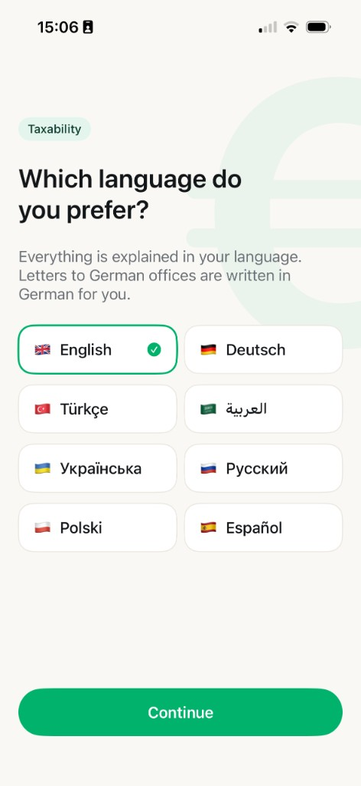
  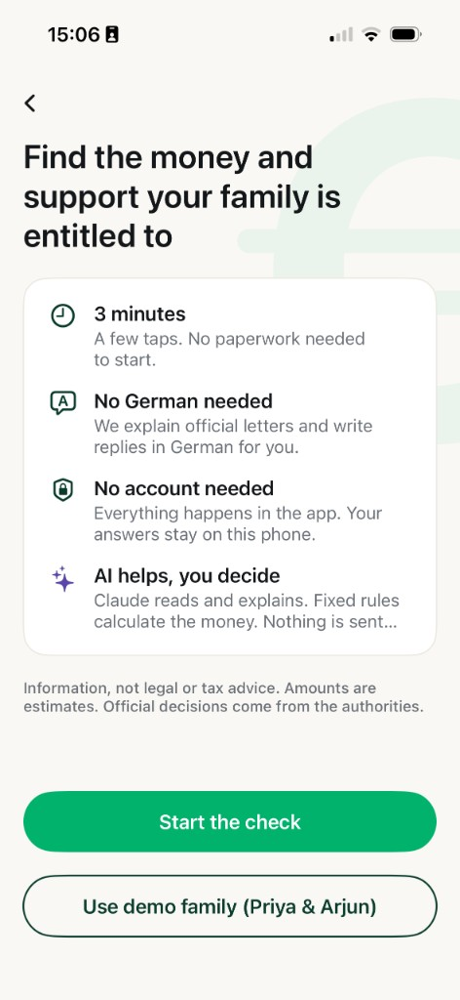
  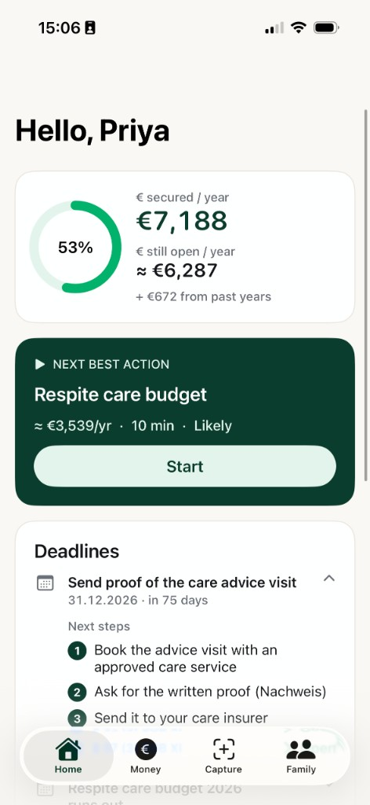
  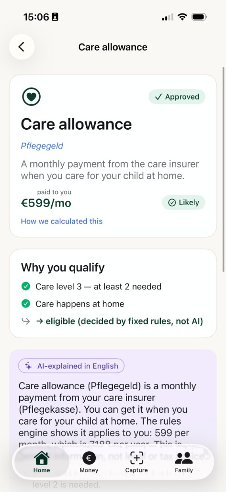
  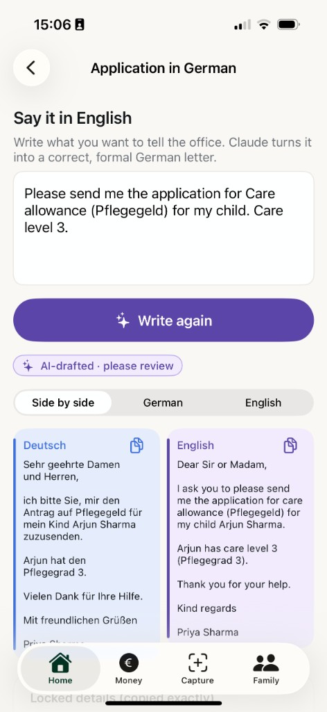
</p>

Language choice → welcome → dashboard (€ secured, next best action, deadlines with next steps) → an explainable card (fixed rules decide, Claude explains) → a German letter written by Claude, side by side with a translation.

### Pitch deck
Download: [`docs/Taxability-Video-Pitch.pptx`](docs/Taxability-Video-Pitch.pptx)

<p>
  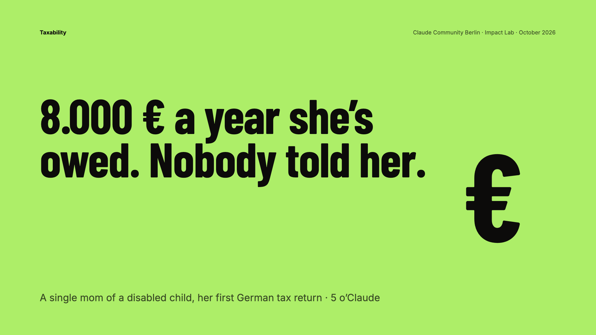
  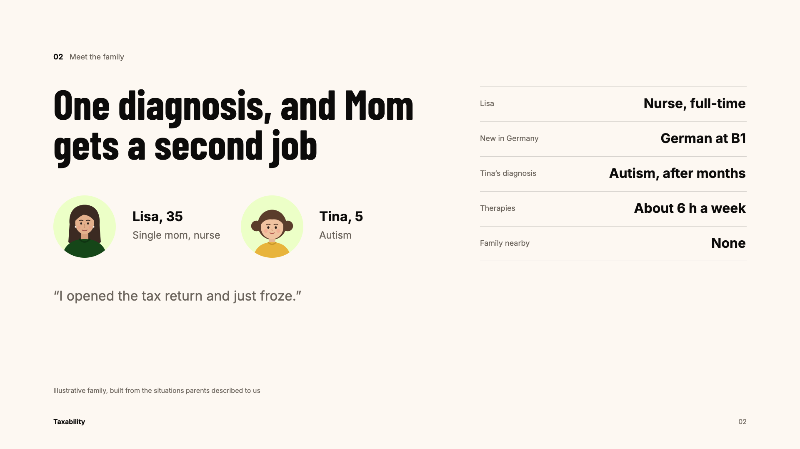
  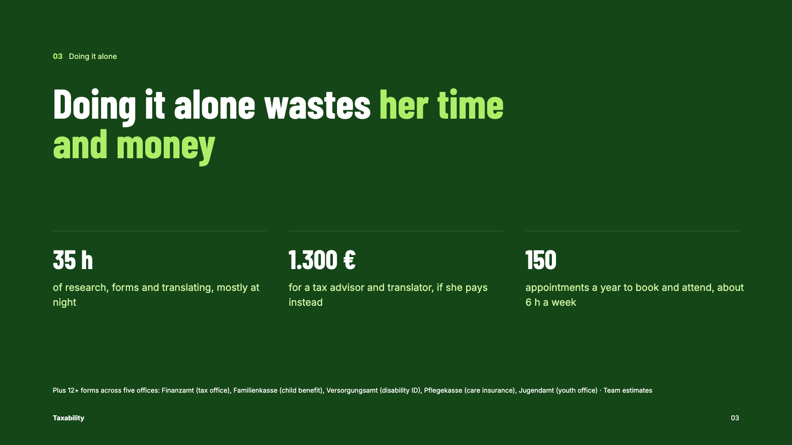
  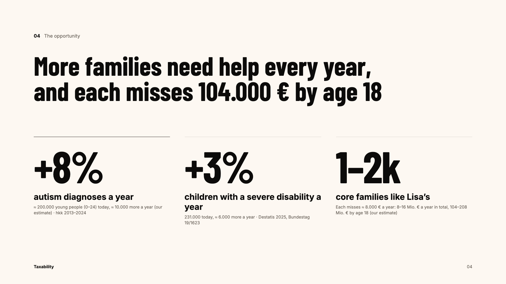
  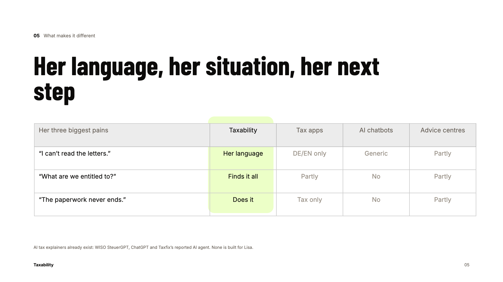
  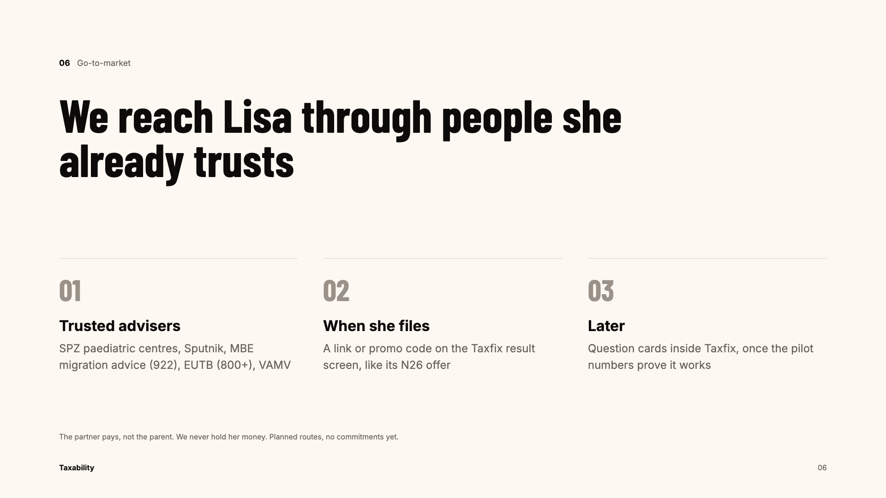
  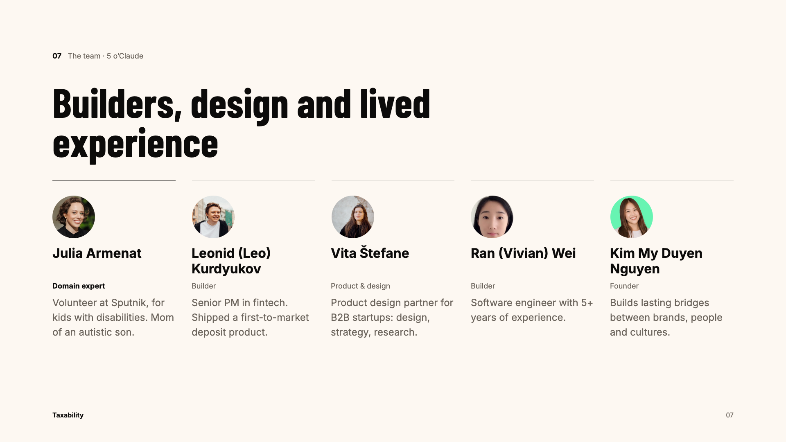
  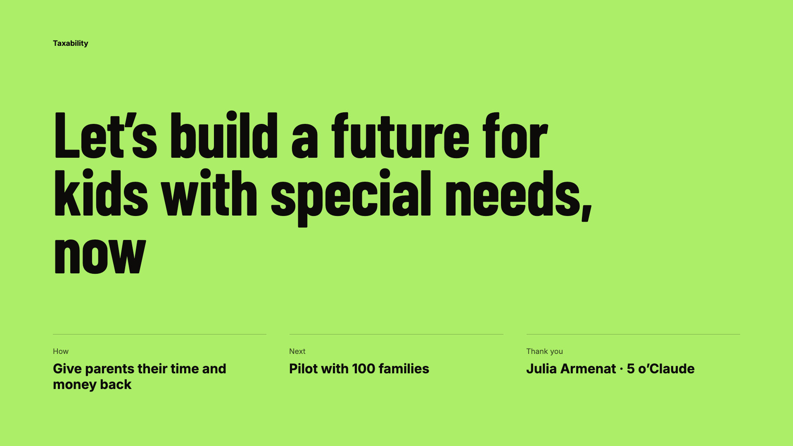
</p>

## Team · 5 o'Claude
Builders, design and lived experience.

| Name | Role | Background |
|---|---|---|
| Julia Armenat | Domain expert | Volunteer at Sputnik, for kids with disabilities. Mom of an autistic son. |
| [Leonid (Leo) Kurdyukov](https://github.com/Levanidd) | Builder | Senior PM in fintech. Shipped a first-to-market deposit product. |
| [Vita Štefane](https://github.com/vitast) | Product & design | Product design partner for B2B startups: design, strategy, research. |
| Ran (Vivian) Wei | Builder | Software engineer with 5+ years of experience. |
| Kim My Duyen Nguyen | Founder | Builds lasting bridges between brands, people and cultures. |

## Credits
- [Claude API](https://docs.claude.com) by Anthropic — document reading, explanations, German letters.
- Apple SwiftUI, PhotosUI and SF Symbols.
- [Cloudflare Workers](https://developers.cloudflare.com/workers/) and Wrangler — hosting for the backend.
- Rule amounts compiled from §33b EStG and SGB XI (gesetze-im-internet.de) and the secondary sources listed in `Project context.MD`.
- Market figures: hkk health insurer autism data 2013–2024, Destatis 2025 severe-disability statistics, Bundestag printed paper 19/1623. Extrapolations and per-family amounts are team estimates.
- Colours approximate the Taxfix brand; no Taxfix logos or illustrations are used. All documents are fictional "MUSTER" samples, no real personal data.
